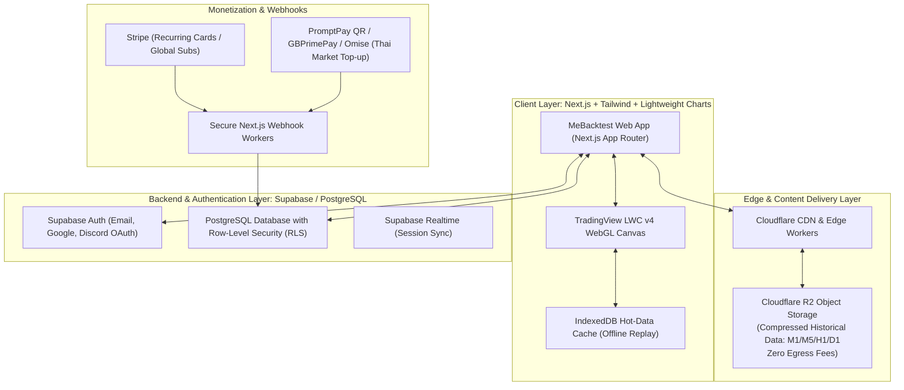

# MeBacktest — Commercial SaaS Architecture Blueprint & Roadmap

พิมพ์เขียวสถาปัตยกรรมระดับองค์กร (Enterprise SaaS Blueprint) สำหรับพัฒนา **MeBacktest** ให้เป็นแพลตฟอร์มจำลองการเทรดและวิเคราะห์สถิติเพื่อออกสู่ตลาดเชิงพาณิชย์ (Commercial Product) รองรับทั้งระบบสมาชิกรายเดือน (Subscription), ระบบเติมเงิน (Top-up/Credit), ฐานข้อมูลผู้ใช้บนคลาวด์ และระบบประมวลผลข้อมูลแท่งเทียนความเร็วสูง

---

## 1. Executive Product Vision & Target Positioning

* **Core Identity**: "TradingView-Class Replay Speed + FX Replay Prop Simulation + TradeZella Deep Analytics — 100% Focused on Price Action & Gold Traders"
* **Target Audience**: 
  1. นักเทรดทองคำ (XAUUSD Scalpers / Day Traders) ที่ต้องการเครื่องมือซ้อมมือความเร็วสูงระดับ M1
  2. นักเทรดสายสอบพอร์ตจำลอง (Prop Firm Hunters เช่น FTMO, Funding Pips)
  3. สถาบันสอนเทรด / คอมมูนิตี้เทรดเดอร์ (รองรับระบบ Affiliates และ Session Sharing)
* **Delivery Model**: Full Cloud Web SaaS (Modern WebGL Canvas + Cloud Sync) พร้อมออฟไลน์แคชในเบราว์เซอร์

---

## 2. System Topology & Cloud Architecture



---

## 3. Database Schema (PostgreSQL + Supabase RLS)

### 3.1 `users` & `profiles`
```sql
CREATE TABLE public.profiles (
  id UUID PRIMARY KEY REFERENCES auth.users(id) ON DELETE CASCADE,
  email TEXT NOT NULL UNIQUE,
  display_name TEXT,
  avatar_url TEXT,
  tier TEXT NOT NULL DEFAULT 'free' CHECK (tier IN ('free', 'pro_monthly', 'pro_yearly', 'lifetime')),
  credit_balance INTEGER NOT NULL DEFAULT 10, -- เครดิตทดลองใช้สำหรับ Free Tier
  created_at TIMESTAMPTZ NOT NULL DEFAULT timezone('utc', now()),
  updated_at TIMESTAMPTZ NOT NULL DEFAULT timezone('utc', now())
);
```

### 3.2 `subscriptions` & `payment_transactions`
```sql
CREATE TABLE public.subscriptions (
  id UUID PRIMARY KEY DEFAULT gen_random_uuid(),
  user_id UUID NOT NULL REFERENCES public.profiles(id) ON DELETE CASCADE,
  provider TEXT NOT NULL CHECK (provider IN ('stripe', 'promptpay_pass')),
  stripe_customer_id TEXT,
  stripe_subscription_id TEXT,
  plan_id TEXT NOT NULL,
  status TEXT NOT NULL CHECK (status IN ('active', 'past_due', 'canceled', 'expired')),
  current_period_start TIMESTAMPTZ NOT NULL,
  current_period_end TIMESTAMPTZ NOT NULL,
  cancel_at_period_end BOOLEAN DEFAULT FALSE,
  created_at TIMESTAMPTZ DEFAULT timezone('utc', now())
);

CREATE TABLE public.transactions (
  id UUID PRIMARY KEY DEFAULT gen_random_uuid(),
  user_id UUID NOT NULL REFERENCES public.profiles(id) ON DELETE CASCADE,
  amount_thb NUMERIC(10, 2) NOT NULL,
  amount_usd NUMERIC(10, 2),
  type TEXT NOT NULL CHECK (type IN ('subscription', 'topup_credits', 'day_pass')),
  provider TEXT NOT NULL CHECK (provider IN ('stripe', 'promptpay', 'gbprimepay')),
  status TEXT NOT NULL DEFAULT 'pending' CHECK (status IN ('pending', 'completed', 'failed')),
  credits_awarded INTEGER DEFAULT 0,
  reference_id TEXT UNIQUE,
  created_at TIMESTAMPTZ DEFAULT timezone('utc', now())
);
```

### 3.3 `replay_sessions` & `trades` (Cloud Journal)
```sql
CREATE TABLE public.replay_sessions (
  id UUID PRIMARY KEY DEFAULT gen_random_uuid(),
  user_id UUID NOT NULL REFERENCES public.profiles(id) ON DELETE CASCADE,
  title TEXT NOT NULL,
  symbol TEXT NOT NULL DEFAULT 'XAUUSD',
  timeframe TEXT NOT NULL,
  mode TEXT NOT NULL CHECK (mode IN ('normal', 'blind', 'prop_firm')),
  initial_balance NUMERIC(12, 2) NOT NULL DEFAULT 10000.00,
  final_equity NUMERIC(12, 2) NOT NULL,
  net_profit NUMERIC(12, 2) NOT NULL,
  win_rate NUMERIC(5, 2) NOT NULL,
  profit_factor NUMERIC(6, 2) NOT NULL,
  max_drawdown_pct NUMERIC(5, 2) NOT NULL,
  is_prop_breached BOOLEAN DEFAULT FALSE,
  created_at TIMESTAMPTZ DEFAULT timezone('utc', now())
);

CREATE TABLE public.trades (
  id UUID PRIMARY KEY DEFAULT gen_random_uuid(),
  session_id UUID NOT NULL REFERENCES public.replay_sessions(id) ON DELETE CASCADE,
  user_id UUID NOT NULL REFERENCES public.profiles(id) ON DELETE CASCADE,
  symbol TEXT NOT NULL,
  type TEXT NOT NULL CHECK (type IN ('BUY', 'SELL')),
  volume NUMERIC(6, 2) NOT NULL,
  entry_price NUMERIC(10, 3) NOT NULL,
  exit_price NUMERIC(10, 3) NOT NULL,
  stop_loss NUMERIC(10, 3),
  take_profit NUMERIC(10, 3),
  realized_pnl NUMERIC(12, 2) NOT NULL,
  pips NUMERIC(8, 1) NOT NULL,
  close_reason TEXT NOT NULL CHECK (close_reason IN ('MANUAL', 'SL', 'TP', 'BE', 'PARTIAL')),
  setup_tag TEXT, -- e.g. 'Liquidity Sweep', 'FVG Rejection', 'Breakout'
  notes TEXT,
  entry_time BIGINT NOT NULL,
  exit_time BIGINT NOT NULL,
  created_at TIMESTAMPTZ DEFAULT timezone('utc', now())
);
```

---

## 4. Monetization & Tiering Blueprint

| แพ็กเกจ (Tier) | ราคาโดยประมาณ | สิทธิ์การใช้งาน (Entitlements) | กลุ่มเป้าหมาย |
| :--- | :--- | :--- | :--- |
| **Free Starter** | ฿0 (ฟรีตลอดชีพ) | • Timeframe M15, H1, D1<br>• ข้อมูลย้อนหลัง 3 เดือนล่าสุด<br>• บันทึก Journal 50 ออเดอร์<br>• มีลายน้ำ MeBacktest | ผู้ใช้ใหม่ / นักเทรดมือใหม่หัดฝึก |
| **Top-up Pass (เติมเงิน)** | • ฿99 / 3-Day Pass<br>• ฿199 / 7-Day Pass<br>• เหรียญ ฿1 = 1 Session | • ปลดล็อกทุกฟังก์ชันเหมือน Pro ชั่วคราว<br>• ไม่ต้องผูกบัตรเครดิต<br>• สแกน PromptPay ใช้งานได้ทันที | นักเรียน/คนเทรดวันหยุด ที่ไม่อยากจ่ายรายเดือน |
| **Pro Monthly** | ฿490 / เดือน ($14.90) | • ปลดล็อก M1 ไม่จำกัดประวัติย้อนหลัง<br>• Unlimited Replay & Blind Drill<br>• FTMO Prop Firm Simulator Mode<br>• บันทึก Cloud Journal ไม่จำกัด<br>• นำเข้า Custom CSV ส่วนตัวได้ | นักเทรดจริงจัง / สายสอบพอร์ต Prop Firm |
| **Pro Yearly** | ฿4,500 / ปี ($139) | • สิทธิ์ Pro ครบทุกอย่าง<br>• ส่วนลด 25% (คิดเป็น ฿375/เดือน)<br>• สิทธิ์เข้าถึงชุดข้อมูล Tick Data และฟีเจอร์เบต้าก่อนใคร | นักเทรด Full-Time / สมาชิกประจำ |

---

## 5. แผนการพัฒนา 5 เฟส (5-Phase Production Roadmap)

### Phase 1: การยกระดับ Core Engine ในโฟลเดอร์ปัจจุบัน (Sprint 1)
- [x] Bar Replay Engine ความเร็วสูง 60 FPS
- [x] ชุดข้อมูลทองคำ M1, M5, M15, H1, D1
- [x] ปุ่ม Break-Even (BE), ปุ่มปิด 50%, และจำลอง Spread
- [x] Indicators EMA 20, 50, 200 และตัวเลื่อนขอบกราฟ (Chart Shift)
- [x] **Prop Firm Mode Widget**: เพิ่มกล่องตรวจจับกฎ FTMO (Max Daily Loss 5%, Max Loss 10%, High-Watermark Listener)
- [x] **Core Drawing Tools**: วาดกล่องโซน (Rectangle) สำหรับ Supply/Demand และเส้นแนวนอน (Horizontal Ray)
- [x] **Setup Tagging**: เมนูเลือกเหตุผลในการเข้าออเดอร์ก่อนกดเทรด และแสดงผล Strategy Breakdown Analytics

### Phase 2: ระบบคลาวด์และฐานข้อมูล (Cloud & Auth Layer) (Sprint 2)
- [ ] Scaffold Next.js 15 App Router ร่วมกับสแต็กเดิม
- [ ] เชื่อมโยง Supabase Authentication (Email, Google, Discord Login)
- [ ] ติดตั้ง Row-Level Security (RLS) สำหรับจัดเก็บประวัติ Session และ Trades
- [ ] สร้างระบบ Cloud Sync บันทึกและดึง Trade Journal ข้ามอุปกรณ์

### Phase 3: คลังข้อมูลขนาดใหญ่และการจัดส่ง (Data Lake & CDN) (Sprint 3)
- [ ] ติดตั้ง Cloudflare R2 สำหรับเก็บไฟล์ Parquet / Chunked JSON (XAUUSD, EURUSD, GBPUSD, BTCUSD)
- [ ] สร้าง Data Pre-fetching และ Streaming Pipeline ที่ดึงแท่งเทียนเข้าสู่เบราว์เซอร์อย่างรวดเร็ว
- [ ] สร้างระบบ Local IndexedDB Caching เพื่อให้โหลดครั้งเดียวแล้วเปิดเล่นได้เร็วทันที

### Phase 4: ระบบการเงินและการสมัครสมาชิก (Monetization & Webhooks) (Sprint 4)
- [ ] เชื่อมต่อ Stripe Checkout & Billing Portal (Recurring Subscription รายเดือน/รายปี)
- [ ] เชื่อมต่อ PromptPay QR Code (สำหรับคนไทย: เติมเงิน / ซื้อ Day Pass)
- [ ] สร้าง Webhook Listener อัปเดตสิทธิ์ผู้ใช้ในฐานข้อมูลทันทีเมื่อชำระเงินสำเร็จ
- [ ] สร้างหน้า Account / Billing Settings สำหรับจัดการแพ็กเกจ

### Phase 5: การเปิดตัวสู่ตลาดและขยายผล (Go-to-Market & Scale) (Sprint 5)
- [ ] หน้า Landing Page ระดับเวิลด์คลาส พร้อม Demo Replay แบบไม่ต้องล็อกอิน
- [ ] ระบบ Affiliate / Referral (ค่าคอมมิชชัน 20-30% สำหรับครูสอนเทรดและอินฟลูเอนเซอร์)
- [ ] SEO & Social Share: แชร์รูปการ์ดสรุปผลการเทรด (P&L Card / Certificate) ลง Facebook, X, Discord
- [ ] Production Launch & Public Release

---

## 6. โครงสร้างโฟลเดอร์โปรเจกต์เชิงพาณิชย์ (Directory Architecture)

ตำแหน่งที่ตั้ง: `D:\METHA\Projects\mebacktest`

```
mebacktest/
├── .git/
├── public/
│   ├── data/                      # Local Bundled Datasets (M1-D1)
│   └── branding/                  # Logo, Favicons, Social Preview Cards
├── src/
│   ├── app/                       # Next.js App Router (Auth, Dashboard, Terminal, Billing)
│   │   ├── (auth)/login/
│   │   ├── (dashboard)/journal/
│   │   ├── terminal/page.tsx      # Main Trading Replay Terminal
│   │   └── api/webhooks/
│   ├── components/
│   │   ├── chart/                 # TradingView LWC Chart, Overlays, Drawings
│   │   ├── controls/              # Replay Floating Controls, Shift Sliders
│   │   ├── execution/             # Order Panel, Position Table, BE & Partial
│   │   ├── prop-firm/             # FTMO Challenge HUD, Drawdown Meters
│   │   └── journal/               # Analytics Modals, Equity Graphs, Setup Tags
│   ├── core/                      # Pure Business Logic (Zero-Dependency Deep Modules)
│   │   ├── ReplayEngine.ts        # Time Cursor & State Machine
│   │   ├── GoldTradingEngine.ts   # PnL Math, Spread, SL/TP Triggers
│   │   ├── PropFirmEngine.ts      # FTMO Drawdown & Watermark Evaluator
│   │   ├── DrawingEngine.ts       # Canvas Drawings (Zones, Lines)
│   │   └── indicators.ts          # EMA, ATR, Session Boxes
│   ├── lib/
│   │   ├── supabase/              # Client & Server DB Helpers
│   │   ├── stripe/                # Stripe API & Checkout
│   │   └── storage/               # R2 Cloud Storage Fetcher & IndexedDB
│   └── types/
│       ├── candle.ts
│       ├── trade.ts
│       ├── replay.ts
│       └── billing.ts
├── tests/                         # Vitest Test Suites
├── BLUEPRINT.md                   # เอกสารพิมพ์เขียวสถาปัตยกรรม (ไฟล์นี้)
├── ROADMAP.md                     # แผนงานและรายการงานย่อย
├── package.json
└── vite.config.ts / next.config.mjs
```
